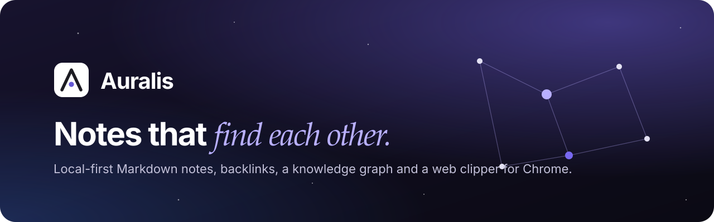

  

  
  
  
  

  <a href="https://github.com/kasinathanb-AOT/auralis-releases/releases/latest/download/auralis.zip"><b>Download auralis.zip</b></a>
  &nbsp;·&nbsp;
  <a href="https://auralisweb.vercel.app">Website</a>
  &nbsp;·&nbsp;
  <a href="https://auralisweb.vercel.app/premium">Premium</a>
  &nbsp;·&nbsp;
  <a href="https://auralisweb.vercel.app/support">Support</a>

---

**Auralis** is a local-first Markdown knowledge workspace that lives in your browser. Write notes, connect them
with `[[wikilinks]]`, watch the connections grow in a knowledge graph, and clip anything on the web straight into
your notes. Everything is stored on your device in IndexedDB and works offline. No account is needed.

This repository hosts the downloadable builds of the extension. The source code is private.

## Contents

- [Features](#features)
- [Install](#install)
- [Update](#update)
- [Keyboard shortcuts](#keyboard-shortcuts)
- [Free and Premium](#free-and-premium)
- [Your data and privacy](#your-data-and-privacy)
- [Permissions](#permissions)
- [Release history](#release-history)
- [Support](#support)

## Features

| | |
|---|---|
| **Linked notes** | `[[Wikilinks]]` with heading links and aliases, backlinks, linked and unlinked mentions, and related notes. Renaming a note rewrites every link to it. |
| **Knowledge graph** | Global and local graphs with filters, search, hover previews and zoom. |
| **Web clipper** | Save an article, a selection or a bookmark from the toolbar popup, the side panel or the right-click menu. Add tags, an annotation and a destination folder. |
| **Rich Markdown editor** | Live preview, source and reading modes. Tables, checklists, code with syntax highlighting, LaTeX math, YAML properties, image embeds and `/` slash commands. |
| **Search everything** | `Ctrl+K` searches notes, folders and commands. Filters: `"exact phrase"`, `-exclude`, `tag:`, `path:`, `type:clip`, `title:` and any property, such as `status:done`. |
| **Workspace** | Today home with quick capture, daily notes, bookmarks, templates, tabs and split panes, outline and properties panels. |
| **Canvas** | Lay notes out spatially on an infinite canvas. |
| **Side panel** | Notes related to the site you are on, quick notes and an inline editor, next to any web page. |
| **Share Hub** | Share notes with other Auralis accounts as viewer or editor. Editors edit in place. |
| **Backup and import** | Export everything as a zip of plain Markdown files. Import that zip, any zip of `.md` files or a folder of Markdown. |
| **Themes** | Clean white theme by default, with a dark theme option. |

## Install

Auralis is not on the Chrome Web Store yet. Install it as an unpacked extension:

1. Download **[auralis.zip](https://github.com/kasinathanb-AOT/auralis-releases/releases/latest/download/auralis.zip)** and unzip it to a folder you will keep, for example `Documents\Auralis`.
2. Open `chrome://extensions` and turn on **Developer mode** (top right).
3. Click **Load unpacked** and choose the unzipped folder.
4. Pin Auralis to the toolbar. Click it for quick capture, or press `Alt+Shift+K` to open the workspace.

Works in Chrome 116 or later and in other Chromium browsers, such as Edge, Brave and Arc.

> [!IMPORTANT]
> Do not delete or move the unzipped folder after installing. Chrome loads the extension from it.

## Update

Auralis checks this repository twice a day. **Settings > Updates** shows the installed and latest versions,
and the status bar offers **Update to x.y.z** when a new release is out.

**One-click updates on Windows:** run `updater\install-updater.cmd` from the extension folder once. After that,
updates download and install in place and Auralis restarts. Your notes are kept, because the folder and the
extension ID stay the same.

**Manual update:** download the new `auralis.zip`, unzip it over the same folder, and click **Reload** on the
Auralis card in `chrome://extensions`.

> [!WARNING]
> **Upgrading from 0.4.0 or earlier to 0.5.0 or later:** back up your notes first (**Settings > Backup, import & export**, or a cloud backup on Premium).
> Version 0.5.0 pinned the extension ID, so notes from older installs do not appear until you restore that backup.
> On Windows, also run `updater\install-updater.cmd` again.

## Keyboard shortcuts

**Browser-wide** (change them at `chrome://extensions/shortcuts`):

| Shortcut | Action |
|---|---|
| `Alt+Shift+K` | Open the workspace |
| `Alt+Shift+S` | Clip the current page |

**In the workspace** (change them in **Settings**):

| Shortcut | Action |
|---|---|
| `Ctrl+K` | Search notes, folders and actions |
| `Ctrl+P` | Command palette |
| `Ctrl+O` | Quick switcher (type a new title to create a note) |
| `Alt+N` / `Alt+Shift+N` | New note / new note from a template |
| `Ctrl+D` | Today's daily note |
| `Ctrl+E` | Cycle live preview, source and reading mode |
| `Ctrl+Shift+F` | Search all notes |
| `Ctrl+G` | Global graph |
| `Ctrl+\` / `Ctrl+Shift+\` | Split the pane right / down |
| `Alt+W` | Close tab |
| `Ctrl+Shift+L` / `Ctrl+Shift+R` | Toggle the left / right sidebar |
| `F2` | Rename note |
| `Ctrl+,` | Settings |

## Free and Premium

Auralis is free, with no account, no limits on notes and no ads. Premium is optional and adds cloud features.

| | Free | Premium |
|---|:---:|:---:|
| Unlimited notes, graph, clipper, canvas, search | ✓ | ✓ |
| Zip backup, restore and Markdown import | ✓ | ✓ |
| Works offline, no account needed | ✓ | ✓ |
| Share notes with other accounts | Up to 5 notes | Unlimited |
| Cloud backup and restore on any computer | | ✓ |
| Automatic daily cloud backup (newest 30 kept) | | ✓ |
| **Price** | **Free** | **₹199 / month** or **₹1,999 / year** |

Sign in with email and password, a one-time email code, or Google. Manage or cancel your subscription in
**Settings > Account & cloud backup**. See [Premium](https://auralisweb.vercel.app/premium),
[Terms](https://auralisweb.vercel.app/terms) and [Refunds](https://auralisweb.vercel.app/refunds).

## Your data and privacy

- Notes, folders and attachments are stored in your browser's IndexedDB, on your device.
- Markdown is stored as you wrote it, and a backup is plain `.md` files in folders. You can always take your notes elsewhere.
- Note content leaves your device only when you make a cloud backup or share a note while signed in.
- The extension has no analytics, no advertising and no telemetry.

Read the full [privacy policy](https://auralisweb.vercel.app/privacy).

## Permissions

| Permission | Why |
|---|---|
| `storage`, `unlimitedStorage` | Keep your notes and attachments on your device |
| `sidePanel` | Show the Auralis side panel |
| `activeTab`, `scripting` | Clip the page you are on, only when you ask |
| `contextMenus` | Add *Save selection*, *Clip this page* and *Bookmark this page* to the right-click menu |
| `identity` | Sign in with Google (Premium and sharing) |
| `alarms` | Check for updates and run the daily cloud backup |

Access to other sites is requested only when you clip from the side panel.

## Release history

| Version | Highlights |
|---|---|
| [0.5.0](https://github.com/kasinathanb-AOT/auralis-releases/releases/tag/v0.5.0) | Pinned extension ID, so Google sign-in works on every computer |
| [0.4.0](https://github.com/kasinathanb-AOT/auralis-releases/releases/tag/v0.4.0) | Share Hub: *Shared with me* and *Shared by me*, sharing between signed-in accounts |
| [0.3.0](https://github.com/kasinathanb-AOT/auralis-releases/releases/tag/v0.3.0) | Note sharing, in-app update checks and one-click updates on Windows |
| [0.2.0](https://github.com/kasinathanb-AOT/auralis-releases/releases/tag/v0.2.0) | Auralis Premium: account, cloud backup and daily automatic backups |
| 0.1.0 | First release: notes, wikilinks, graph, clipper, canvas, search and backup |

Full notes for each version are on the [Releases](https://github.com/kasinathanb-AOT/auralis-releases/releases) page.

## Support

Found a bug or have an idea? Visit the [support page](https://auralisweb.vercel.app/support) or
[open an issue](https://github.com/kasinathanb-AOT/auralis-releases/issues) in this repository.

   
  Made for people who think in links.

